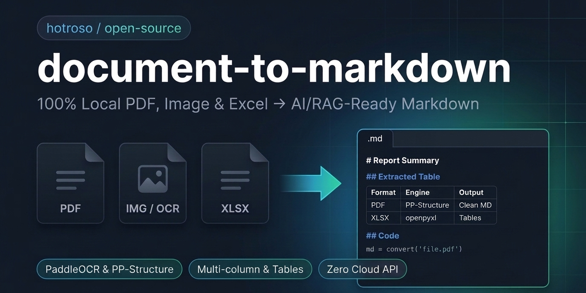

# Document to Markdown

[](https://github.com/hotroso/document-to-markdown/actions/workflows/ci.yml)
[](https://pypi.org/project/document-to-markdown/)
[](https://github.com/hotroso/document-to-markdown/releases)
[](https://github.com/hotroso/document-to-markdown/releases)
[](pyproject.toml)
[](LICENSE)
[](https://github.com/hotroso/document-to-markdown/stargazers)



Local, zero-config converter for **PDF**, **Office (DOCX, PPTX, Excel)**, **Email (EML/Outlook MSG)**, **HTML**, **CSV/TSV**, and **images** into clean, AI/RAG-ready **Markdown**.

Designed for personal and enterprise AI, LLM, and RAG workflows where document layouts vary wildly and you want clean `.md` files out of the box without complex setup or cloud APIs.

## Highlights

- **Clean Markdown by default**: Outputs only the `.md` file by default. Extracted image/attachment folders (`_assets`) and JSON metadata sidecars (`.meta.json`) are opt-in via `--assets` and `--meta`.
- **Broad local document support out of the box**: Zero extra dependencies for **Word (`.docx`)**, **PowerPoint (`.pptx` with speaker notes)**, **Email (`.eml`)**, **HTML**, and **CSV/TSV**, plus **PDF**, **Excel (`.xlsx`/`.xlsm`)**, **images**, and optional **Outlook (`.msg`)**.
- **Layout-aware PDF & Image conversion**: Combines native PDF text & table extraction (`pdfplumber` + `pypdfium2`) with automatic OCR on scanned or image-heavy pages, powered by **PP-Structure / PP-StructureV3** and **PaddleOCR** (with **Tesseract** fallback).
- **Simple multilingual OCR**: Defaults to `--lang vie`, which handles **Vietnamese, English, and Latin-script text** out of the box in PaddleOCR. Combined specifications such as `eng+vie` or `eng+jpn` automatically select the broader recognition model instead of dropping secondary languages.
- **Phone photo & scan friendly**: Automatically applies EXIF orientation correction, handles multi-page TIFFs, detects multi-column reading order, and removes repeated page headers/footers.
- **Smart Excel ingestion**: Splits multi-region worksheets into separate tables, expands merged cells, and resolves formula values via cached Excel values, headless LibreOffice recalculation, or optional pure-Python evaluation.
- **100% local**: Everything runs on your machine (PaddleOCR downloads models once on first run).

## Supported Formats

| Input | Extensions | Capabilities |
|-------|------------|--------------|
| **PDF** | `.pdf` | Native text extraction + automatic OCR on scanned/image-dominated pages, multi-column ordering, repeated header/footer removal, password prompt (`--password`), optional image export (`--assets`). |
| **Images** | `.png`, `.jpg`, `.jpeg`, `.webp`, `.bmp`, `.tif`, `.tiff` | EXIF auto-rotation, multi-frame TIFF support, layout/table analysis (PP-Structure) or line-grouped plain OCR, automatic Tesseract fallback. |
| **Word** | `.docx` | Pure-Python OOXML parsing (zero extra dependencies): headings, paragraphs, hyperlinks, nested ordered/unordered lists, tables with merged cells, tracked-deletion filtering, footnotes, optional `--assets` image export. |
| **PowerPoint** | `.pptx` | True presentation slide ordering, slide titles, visual reading order, nested bullets, tables, **speaker notes**, slide dividers (`---`), optional `--assets` image export. |
| **Excel** | `.xlsx`, `.xlsm` | Multi-region sheet splitting, merged cell handling, 3-tier formula evaluation (cached → LibreOffice → `xlcalculator`), numeric column alignment. |
| **Email** | `.eml`, `.msg` | Headers table (`From`, `To`, `Cc`, `Date`), plain text / HTML body conversion, quoted replies, attachment listing & optional `--assets` export (`.msg` via `[outlook]` / BSD `olefile`). |
| **Web & Tabular** | `.html`, `.htm`, `.csv`, `.tsv` | Clean semantic HTML extraction (headings, lists, code fences, blockquotes, colspan/rowspan tables; strips scripts/styles) and auto-delimiter CSV/TSV tables. |

## Installation

Requires **Python >= 3.10**.

### Install from PyPI (Recommended)

```bash
# Base install (PDF, DOCX, PPTX, Excel, EML, HTML, CSV/TSV)
pip install document-to-markdown

# Recommended: add PaddleOCR + PP-Structure layout/table analysis
pip install "document-to-markdown[ocr]"

# Optional extras: Outlook .msg, Tesseract OCR fallback, or Excel formula engine
pip install "document-to-markdown[outlook]"
pip install "document-to-markdown[tesseract]"
pip install "document-to-markdown[excel-calc]"

# Install everything
pip install "document-to-markdown[all]"
```

### Install Latest from GitHub

```bash
pip install "document-to-markdown[ocr] @ git+https://github.com/hotroso/document-to-markdown.git"
```

### From Local Source (Development)

```bash
git clone https://github.com/hotroso/document-to-markdown.git
cd document-to-markdown

pip install -e .
# or with optional extras: [ocr], [tesseract], [excel-calc], [all]
pip install -e ".[ocr]"
```

> **Note:** On the first OCR / structure run, PaddleOCR automatically downloads detection, recognition, and layout models (a few hundred MB).

For detailed workflows, troubleshooting, and examples, see the [Usage Guide](USAGE.md).

### Prebuilt Installers & Packages

Prebuilt Python packages (`.whl`, `.tar.gz`) and standalone executables (Linux, Windows `.exe`, macOS — bundling native PDF, Excel, and Tesseract OCR support) are automatically built by [GitHub Actions](.github/workflows/release.yml) and published on the [Releases page](https://github.com/hotroso/document-to-markdown/releases). For full PaddleOCR / PP-Structure support, install from source with `pip install -e ".[ocr]"`.

## Usage

After installation, you can run either `document-to-markdown` or `python -m document_converter.cli`.

```bash
# Convert a PDF (outputs report.md only)
document-to-markdown report.pdf

# Convert an image (auto-rotates EXIF, auto-selects PP-Structure / PaddleOCR)
document-to-markdown scan.png

# Convert a bilingual English + Vietnamese PDF with source comments for AI/RAG
document-to-markdown report.pdf --mode ai --lang eng+vie

# Export extracted PDF images (_assets/) and metadata sidecar (.meta.json)
document-to-markdown report.pdf --assets --meta

# Batch convert a whole folder
document-to-markdown data/input -o data/output --mode ai

# Convert an Excel workbook
document-to-markdown report.xlsx -o report.md

# Disable PP-Structure layout analysis (faster plain OCR only)
document-to-markdown complex.pdf --no-structure

# Use lightweight mobile PaddleOCR models (much faster on CPU)
document-to-markdown scan.pdf --ocr-profile mobile --ocr-version PP-OCRv5
```

### CLI Options

| Option | Values / Default | Description |
|--------|------------------|-------------|
| `inputs` | path(s) | Input file(s) or directory(ies) to convert recursively |
| `-o`, `--output` | auto (`<input>.md`) | Output `.md` file path or output directory |
| `--mode` | `balanced` (default), `fidelity`, `ai` | Markdown style (`fidelity`/`ai` include source location comments; `ai` suppresses inline warning blockquotes) |
| `--ocr` | `auto` (default), `paddle`, `tesseract`, `off` | OCR backend (`auto` prefers PaddleOCR / PP-Structure and falls back to Tesseract) |
| `--lang` | `vie` (default), `eng`, `eng+vie`, … | OCR language (`vie` covers Vietnamese + English/Latin in PaddleOCR) |
| `--ocr-profile` | `auto` (default), `mobile`, `server` | PaddleOCR model profile (`mobile` uses lightweight detection for much faster CPU inference) |
| `--ocr-version` | unset (Paddle default) | PaddleOCR model version (e.g. `PP-OCRv5`, `PP-OCRv4`, `PP-OCRv3`) |
| `--det-model` | unset | Explicit PaddleOCR text detection model name (e.g. `PP-OCRv5_mobile_det`) |
| `--rec-model` | unset | Explicit PaddleOCR text recognition model name (e.g. `latin_PP-OCRv5_mobile_rec`) |
| `--no-structure` | flag | Disable PP-Structure layout/table analysis and use plain OCR only |
| `--assets`, `--images` | flag | Export images extracted from PDF into `<stem>_assets/` |
| `--meta` | flag | Export machine-readable `<stem>.meta.json` metadata sidecar |
| `--preview` | flag | Convert only the first 3 pages of a PDF |
| `--password` | flag | Prompt for a password on encrypted PDFs |
| `--no-recalculate` | flag | Skip LibreOffice / pure-Python Excel formula recalculation |
| `--version` | flag | Print package version and exit |
| `-v`, `--verbose` | flag | Enable debug logging |

## Python API

```python
from document_converter import convert_file

output_md = convert_file(
    "report.pdf",
    "output/report.md",
    mode="balanced",       # "balanced" | "fidelity" | "ai"
    ocr="auto",            # "auto" | "paddle" | "tesseract" | "off"
    ocr_lang="vie",        # "vie", "eng", "eng+vie", ...
    ocr_profile="auto",    # "auto" | "mobile" | "server"
    ocr_version=None,      # e.g. "PP-OCRv5", "PP-OCRv4"
    det_model=None,        # e.g. "PP-OCRv5_mobile_det"
    rec_model=None,        # e.g. "latin_PP-OCRv5_mobile_rec"
    export_images=False,   # True to create output/report_assets/
    export_meta=False,     # True to create output/report.meta.json
)
```

## How It Works

### PDF & Image Layout Analysis
1. For PDFs in `--ocr auto` mode, pages with native text and ruled tables are extracted directly via `pdfplumber` with multi-column clustering.
2. Scanned pages (little native text) or image-dominated pages (images covering `>= 35%` of the page) are rendered with `pypdfium2` and automatically routed to OCR.
3. When PaddleOCR + PP-Structure is available (default), layout regions (titles, headings, paragraphs, lists, HTML tables) are reconstructed in reading order. Otherwise it falls back gracefully to line-grouped plain PaddleOCR or Tesseract.

### Excel Formula Evaluation (Multi-Tier)
When a workbook contains formulas, the converter resolves cell values in order:
1. **Cached values** already saved in the `.xlsx` file (fastest).
2. **LibreOffice** headless recalculation on a temporary copy (most compatible, requires `soffice` or `libreoffice` on `PATH`).
3. **Pure-Python** evaluation via the optional MIT-licensed `xlcalculator` package (`pip install -e ".[excel-calc]"`).
4. Retain the formula text and emit a conversion warning if no calculated value is available.

## Limitations

- Legacy `.xls`, `.doc`, and `.ppt` files are not supported directly (convert them to `.xlsx`/`.docx`/`.pptx` first, e.g. with LibreOffice).
- Heavily nested tables or handwritten forms remain challenging for local OCR.
- PP-Structure with high-DPI page rendering uses more CPU/RAM than plain native PDF text extraction.
- Pure-Python `xlcalculator` coverage is partial for complex array formulas or Excel-specific functions; LibreOffice is recommended for formula-heavy workbooks.
- Mixing two completely different writing systems in a single PaddleOCR pass (e.g., Vietnamese + Japanese on the same page) is limited by single-model recognition dictionaries; use `--ocr tesseract` with system language packs when needed.

## Changelog

### 0.6.1
- Make OCR engine detection truly lazy using `importlib.util.find_spec` and deferring detection in `convert_pdf` until a page actually needs OCR, avoiding heavy PaddleOCR / PaddleX startup imports on digital-only PDFs

### 0.6.0
- Switch project license to **MIT License with Commons Clause v1.0** (source-available) backed by a 100% permissive dependency stack (no AGPL, GPL, or EUPL dependencies)
- Replace `PyMuPDF` (AGPL-3.0) with `pdfplumber` (MIT) + `pypdfium2` (Apache-2.0 / BSD-3-Clause), adding native ruled-table detection for digital PDFs
- Replace `extract-msg` (GPL-3.0) with a native OLE2/MAPI `.msg` parser using `olefile` (BSD-2-Clause)
- Replace `formulas` (EUPL-1.2) with `xlcalculator` (MIT) for optional pure-Python Excel formula evaluation

### 0.5.0
- Add zero-dependency native adapters for Word (`.docx` with headings, nested lists, merged-cell tables, hyperlinks, tracked-deletion filtering, footnotes, `--assets`), PowerPoint (`.pptx` with true slide order, bullets, tables, speaker notes, `--assets`), Email (`.eml`), HTML (`.html`/`.htm` with code blocks, blockquotes, colspan/rowspan tables), and CSV/TSV (`.csv`/`.tsv`)
- Add Outlook `.msg` email support via optional `[outlook]` extra (`extract-msg`, bundled in standalone release binaries)
- Enhance Markdown renderer with nested list indentation, fenced code blocks, and blockquotes

### 0.4.0
- Add optional PaddleOCR model selection across CLI and Python API while preserving defaults: `--ocr-profile` (`auto` | `mobile` | `server`), `--ocr-version` (e.g. `PP-OCRv5`, `PP-OCRv4`, `PP-OCRv3`), `--det-model`, and `--rec-model`
- Key cached OCR / PP-Structure engines by full model configuration and keep graceful fallbacks for `PPStructureV3` and PaddleOCR 2.x

### 0.3.3
- Fix `ValueError: The truth value of an array with more than one element is ambiguous` when reading NumPy array outputs (`rec_texts`, `rec_scores`, `rec_boxes`, `dt_polys`, `bbox`) from PaddleOCR 3.x / PP-Structure and normalize NumPy bounding boxes in `_bbox_rect`
- Add cross-platform PaddlePaddle 3.x PIR/oneDNN (`ConvertPirAttribute2RuntimeAttribute`) mitigation: proactively disable MKLDNN by default on Windows (`PADDLE_PDX_ENABLE_MKLDNN_BYDEFAULT=0` + `enable_mkldnn=False`, overridable via env), honor `FLAGS_use_mkldnn=0` on all platforms, and auto-retry with `enable_mkldnn=False` at runtime if the error occurs

### 0.3.2
- Fix PaddleOCR 3.x+ initialization by omitting the removed `show_log=False` constructor argument and silencing verbose logs via Python `logging`
- Preserve PaddleOCR 2.x constructor fallback (`use_angle_cls`, `show_log=False`, `use_gpu=False`) and handle both `TypeError` and `ValueError` fallbacks across `PaddleOCR`, `PPStructureV3`, and classic `PPStructure`

### 0.3.1
- Make `.md` the sole default output; opt in to `_assets` and `.meta.json` via `--assets` (`--images`) and `--meta`
- Default `--lang` to `vie` (covers Vietnamese + English/Latin in PaddleOCR) and preserve secondary non-English languages in multi-language specs like `eng+vie`
- Add `map_lang_for_tesseract` and shared Tesseract fallback for image inputs
- Fix `PPStructureV3` pre-formatted Markdown escaping and avoid promoting running page headers to headings
- Improve plain OCR visual-line sorting, dynamic paragraph spacing, and multi-column gutter detection
- Auto-apply EXIF orientation, support multi-frame TIFFs, and detect image-dominated PDF pages for OCR

### 0.3.0
- PP-Structure / PP-StructureV3 integration for layout, tables, and reading order
- Direct image file support
- Multi-column clustering for native PDF blocks and OCR lines
- `--no-structure` flag

### 0.2.0
- Primary OCR engine switched to PaddleOCR (Tesseract kept as fallback)
- Language mapping, lazy model loading, improved error recovery

### 0.1.0
- Initial foundation (PDF + Excel + Tesseract)

## License

Released under the [MIT License with Commons Clause v1.0](LICENSE) (source-available).

- **Free to use, modify, and integrate** for personal, educational, research, and internal business workflows.
- **Commercial resale / hosted SaaS restriction**: Under the Commons Clause, selling the software itself or offering a paid product/hosted service whose value derives substantially from `document-to-markdown` requires a separate commercial license from **hotroso** (`hotrogiaiphapso@gmail.com`).
- All runtime dependencies use permissive licenses (MIT, Apache-2.0, BSD, HPND).

## Repository Stats

[](https://star-history.com/#hotroso/document-to-markdown&Date)
